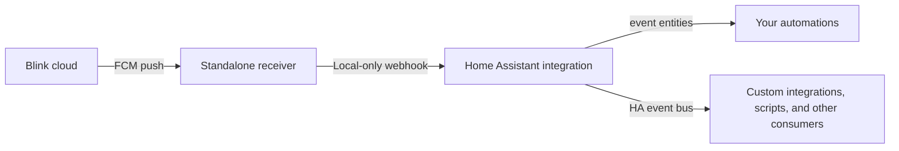

<h1 align="center"></h1>

Receive Blink doorbell presses and camera motion in Home Assistant over Blink's cloud push channel. Events are forwarded as soon as Blink sends them, so automations do not wait for the polling cycle used by Home Assistant's [official Blink integration](https://www.home-assistant.io/integrations/blink/) or for a clip to finish. A Home Assistant custom integration exposes native event entities and a general event-bus event, so you can decide what automations or integrations to build.

This is a community reverse-engineered project, not an official Blink, Amazon, Google, or Home Assistant product. Blink can change its app and cloud API without notice.

## Devices tested

End-to-end push reception and Home Assistant delivery were verified for the Blink Video Doorbell, Blink Mini Pan-Tilt Camera, and two Blink Outdoor 3 cameras below.

| Product | Blink-reported model | Events observed |
| --- | --- | --- |
| Blink Video Doorbell | `lotus` | Button press (`button_press`) and PIR motion (`category=media`, `event_type=pir`) |
| Blink Outdoor 3 (two units) | `catalina` | Motion on both units (`category=motion`, `event_type=cam2sm_motion`) |
| Blink Mini Pan-Tilt Camera (OWL) | `mini/owl` | Motion (`category=media`, `event_type=pir`); forwarded to HA and alert received |

The model identifiers come from Blink's app protocol. Testing covers only the listed hardware and app setup. The receiver does not keep a camera model allowlist: if Blink sends a push from another device with a non-empty `event_type`, it is still forwarded as a generic event for you to inspect and use.

## What you get

- `event.blink_live_events_doorbell` for doorbell presses.
- `event.blink_live_events_camera_motion` for camera motion.
- The `blink_live_events_event` HA event with a sanitized, documented event payload.
- A private, local-only HA webhook endpoint generated during integration setup.
- A standalone Docker Compose receiver for Linux hosts, including ARM64 systems such as Raspberry Pi.

The integration does not install notification automations or require Companion app services. It does not change the official Blink integration, camera entities, or live-view proxies.

## How it works



The receiver holds its own FCM identity and Blink client session. Home Assistant never receives Blink account credentials. The receiver forwards only the event metadata needed for automations; private FCM IDs, Blink account IDs, transaction IDs, and raw push payloads stay in the receiver's private data volume.

## Quickstart

You need Home Assistant 2026.10.0 or newer, plus a Linux host with Docker Compose v2 and outbound internet access. The receiver can run on a separate host from Home Assistant.

1. **Install the Home Assistant integration.** Add this repository to HACS as a custom **Integration** repository, install **Blink Live Events**, and restart Home Assistant. Add the integration, open **Configure → View receiver URL**, and copy the private URL. For a manual install, copy `custom_components/blink_live_events` into `<config>/custom_components/` and restart HA.

2. **Prepare the receiver.** On your Linux Docker host, download the repo and create its private environment file:

   ```sh
   git clone --depth 1 https://github.com/CoreyHayward/ha-blink-live-events.git
   cd ha-blink-live-events
   cp .env.example .env
   chmod 600 .env
   ```

   Put the copied URL in `.env` as `BLINK_LIVE_EVENTS_HA_WEBHOOK_URL`.

3. **Register Blink and start listening.** Run these commands from the repository directory:

   ```sh
   docker compose -f receiver/compose.yaml pull
   docker compose -f receiver/compose.yaml run --rm blink-live-events register-fcm
   docker compose -f receiver/compose.yaml run --rm -it blink-live-events register-blink
   docker compose -f receiver/compose.yaml up -d
   docker compose -f receiver/compose.yaml logs -f blink-live-events
   ```

   `register-blink` opens a Blink-hosted sign-in flow. Complete sign-in and verification in your browser, then paste the full callback URL into the hidden terminal prompt. The receiver never sees your password or verification code. Test with one doorbell press and one separate motion event.

See [Installation](#installation) for manual integration setup, troubleshooting, and security details.

## Installation

The custom integration requires Home Assistant 2026.10.0 or newer.

### 1. Install the Home Assistant integration

In HACS, add this repository as a custom **Integration** repository, install **Blink Live Events**, and restart Home Assistant. To install manually, copy `custom_components/blink_live_events` into `<config>/custom_components/` and restart HA.

In **Settings → Devices & services → Add integration**, add **Blink Live Events**. Open its **Configure** page and select **View receiver URL**. Copy this private URL for the receiver setup. If the URL is exposed, use **Rotate receiver URL** and update the receiver's `.env` file.

### 2. Download the receiver setup files

Use a Linux host with Docker Engine and Docker Compose v2, outbound internet access, and access to your HA local URL. The receiver makes an outbound connection to Google's MCS service (TCP 5228) and sends events to HA. It has no inbound listening port.

Download just the Compose file and environment template; you do not need to clone the source repository:

```sh
mkdir -p blink-live-events/receiver
cd blink-live-events
curl -fsSL https://raw.githubusercontent.com/CoreyHayward/ha-blink-live-events/main/receiver/compose.yaml -o receiver/compose.yaml
curl -fsSL https://raw.githubusercontent.com/CoreyHayward/ha-blink-live-events/main/.env.example -o .env.example
cp .env.example .env
chmod 600 .env
```

The receiver image includes the minimal Firebase client configuration currently used by the Blink Android app, so you do not need to extract values from the app. If Blink changes its Firebase project, override individual values in `.env`; see the [receiver guide](receiver/README.md). These are Firebase client identifiers, not user credentials or FCM registration tokens.

### 3. Register Blink and start listening

Set `BLINK_LIVE_EVENTS_HA_WEBHOOK_URL` in `.env` to the private URL from the integration's Configure screen. The default image tag is `latest`; set `BLINK_LIVE_EVENTS_IMAGE_TAG` to a release such as `v1.0.0` to pin a version. Pull the image for your host architecture:

```sh
docker compose -f receiver/compose.yaml pull
```

Create the independent FCM identity and associate it with Blink:

```sh
docker compose -f receiver/compose.yaml run --rm \
  blink-live-events register-fcm

docker compose -f receiver/compose.yaml run --rm -it blink-live-events register-blink
```

`register-blink` prints a Blink-hosted sign-in URL. Sign in and complete verification in your browser, then paste the full callback URL into the hidden terminal prompt. Your password and verification code are entered only on Blink's page.

Start the service and follow its logs:

```sh
docker compose -f receiver/compose.yaml up -d
docker compose -f receiver/compose.yaml logs -f blink-live-events
```

The listener waits for real Blink pushes. Test one doorbell press and a separate motion-only event to validate your own registration. A connected FCM transport alone does not prove Blink has associated the token.

See [receiver/README.md](receiver/README.md) for registration details, security, and troubleshooting limitations.

### Container image updates and local builds

The **Publish Docker image** job in the Validate workflow publishes multi-architecture `linux/amd64` and `linux/arm64` images to GitHub Container Registry after validation passes on `main` and `v*` tags. On the first public release, run the Validate workflow manually on `main` to publish the initial image; later pushes and version tags publish automatically.

The image is `ghcr.io/coreyhayward/ha-blink-live-events` and can be pulled anonymously; no GHCR login is needed. The default `latest` tag follows successful publications from `main` or a `v*` tag; use a release tag in `.env` to pin a version. To build from source instead, clone the repository and run `docker build -f receiver/Dockerfile -t ghcr.io/coreyhayward/ha-blink-live-events:local .`, then set `BLINK_LIVE_EVENTS_IMAGE_TAG=local` in `.env`.

## Home Assistant event contract

The integration fires `blink_live_events_event` once for every accepted push. Automations, scripts, custom integrations, and event listeners can subscribe to it. Doorbell PIR motion is normalized to `camera_motion` even though Blink reports it with `category=media` and `event_type=pir`. Any other push with a non-empty `event_type` is forwarded as `classification: other`, including events from untested camera models and event types. No per-camera model list is required. Events without an `event_type` are retained privately by the receiver but are not forwarded. The integration keeps native event entities for doorbell presses and motion; generic events remain available through the event bus for custom integrations and automations. Its `event_data` fields are:

| Field | Meaning |
| --- | --- |
| `schema_version` | Integer event contract version, initially `1`. |
| `source` | Always `blink_live_events`. |
| `event_id` | Stable SHA-256 delivery key used by the receiver to suppress duplicate delivery. |
| `classification` | `doorbell_press`, `camera_motion`, or `other` for a new event type. |
| `category` | Blink's notification category when present (`media` or `motion`). |
| `event_type` | Blink's event type, such as `button_press`, `cam2sm_motion`, or doorbell motion's `pir`. |
| `ha_event_type` | HA semantic type: `ring` for a doorbell or `motion` for a camera. |
| `camera_name` | Blink camera name for motion events, when included by Blink. |
| `provider_timestamp` | Provider send time in UTC, when present. |
| `created_at` | Blink event timestamp, when present. |
| `received_at` | Receiver UTC receipt timestamp. |

Optional fields may be absent if the Blink push does not include them. For `other`, the minimum accepted fields are `event_id` and a non-empty `event_type`. The `event_type` field is Blink's raw event type; `ha_event_type` is present only for recognized doorbell and motion events. Event entity states use `ring` and `motion`, and their attributes contain sanitized metadata (with Blink's raw type exposed as `blink_event_type`).

### Build your own automation

One option is to listen to the integration event directly:

```yaml
triggers:
  - trigger: event
    event_type: blink_live_events_event
    event_data:
      classification: camera_motion
conditions: []
actions:
  - action: notify.notify
    data:
      title: Blink motion
      message: "{{ trigger.event.data.camera_name or 'A Blink camera' }} detected motion."
```

For a doorbell, set `classification: doorbell_press`. To handle a type that has not been mapped yet, filter on `classification: other` and branch on the raw `event_type`. Or automate from the native event entities by selecting one as an event trigger in the HA automation editor. An optional starting point is [`examples/automation-event-bus.yaml`](examples/automation-event-bus.yaml); the integration does not install it.

To target one camera, add its exact Blink name as `camera_name` in the event filter. For example, replace `Camera 1` below with the name in your Blink app:

```yaml
triggers:
  - trigger: event
    event_type: blink_live_events_event
    event_data:
      classification: camera_motion
      camera_name: "Camera 1"
```

## Security and limitations

- The HA webhook URL is a secret. HA registers it as local-only; keep the URL and `.env` private and rotate it if exposed.
- Receiver state in the Docker volume includes FCM and Blink session tokens plus private raw-message captures. Protect host backups of that volume.
- The integration and receiver do not send notifications by default.
- FCM token renewal and Blink re-association after rotation are not automated yet. A rejected or expired token may require registration again.
- Blink's app registration and OAuth flow may change. The receiver currently follows the Blink Android 60.0 protocol and needs revalidation after app updates.
- This project receives doorbell and motion events only. It does not provide camera streams or clips; use a separate camera/live-view integration for those.

Protocol notes and validation scope are documented in [the protocol investigation](docs/protocol-investigation.md).

## Development and validation

Run the receiver unit tests with Python 3.12 and its pinned requirements:

```sh
python -m pip install -r receiver/requirements.txt
python -m unittest discover -s receiver/tests -v
```

Run the HA integration tests in a separate Python 3.14 environment because Home Assistant pins an `aiohttp` version that differs from the receiver's BlinkPy dependency:

```sh
python -m pip install -r requirements_test.txt
pytest -q
```

## Support

If Blink Live Events is useful to you, [support the project on PayPal](https://paypal.me/coreyhayward).

## License

Project code is released under the [MIT License](LICENSE). Vendored files retain the license shipped with their original source.
